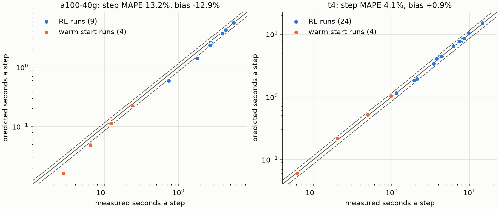
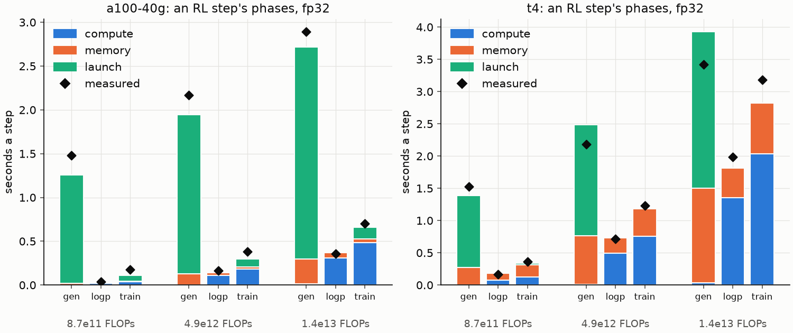
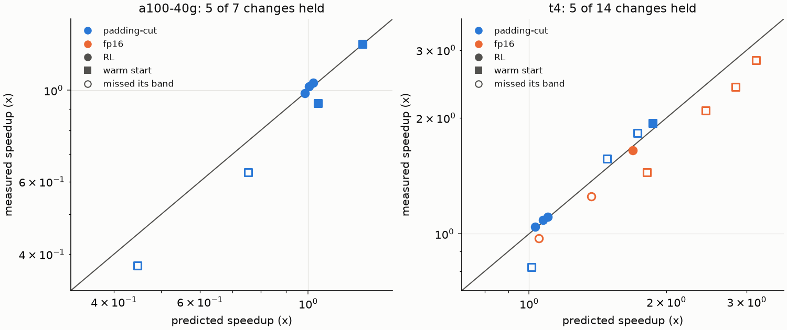

# Write-up 1: a calibrated cost model, and what it says about RL's bottlenecks

ScaleLab M3, 2026-10-26. Figures and tables: `scalelab report cost` (Colab cell N).

## In short

- A roofline cost model, fit only to microbenchmarks of single operations, predicts whole
  training steps it never saw within **4.1% MAPE on a T4** (28 runs) and **13.2% on an A100
  40 GB** (13 runs). M3 asked for 15% on both.
- At our scale (0.8M to 32M parameters, fp32) an RL step is dominated by **sampling, and
  sampling is bound by kernel launches**, not by arithmetic or memory: the model puts 62-80%
  of generation's time on the T4, and 89-98% on the A100, in launch overhead.
- So a faster GPU buys little. The A100 runs the m1-m3 RL steps 1.2-2.2x faster than the T4,
  although its fp32 peak is 2.4x and its bandwidth 4.9x the T4's: log-probs and training
  speed up 2.1-5.5x, generation 1.00-1.18x.
- The model chose two speedups before we built them. Of the 13 changes it said to build, 12
  paid off; the 8 it said to skip were slower or inside its error. The exact speedup landed
  inside its error band in 10 of 21 cases: it overprices changes that add kernel launches or
  that run fp16 kernels it never benchmarked.

## Setup

| model | layers | d_model | heads | parameters |
|---|---:|---:|---:|---:|
| m1 | 4 | 128 | 2 | 0.82M |
| m2 | 6 | 256 | 4 | 4.85M |
| m3 | 8 | 384 | 6 | 14.2M |
| m4 | 10 | 512 | 8 | 31.7M |

- **RL step** (M2's exit runs): GRPO, 64 prompts x 8 samples = 512 answers a step,
  multiplication at 3-4 digits, from M1's warm starts. Three phases: *generate* (sample the
  answers token by token with a KV cache), *logprobs* (the old and reference log-probs, one
  forward each), *train* (forward, backward, AdamW). FLOPs a step: m1 8.7e11, m2 4.95e12,
  m3 1.43e13.
- **Warm-start step**: next-token training on worked solutions (`warmstart.yaml`), train
  only, 8.2e10 (m1) to 2.9e12 (m4) FLOPs a step.
- **Devices**: Colab's T4 (fp32 8.1 TFLOP/s, 320 GB/s) and A100 40 GB (fp32 19.5 TFLOP/s,
  1555 GB/s). Everything is fp32 unless it says fp16.
- **Measured** = the mean of telemetry's CUDA-synced laps over a run's steps after the
  first. **Error** = predicted / measured - 1; MAPE is its mean absolute value over runs.

## How a prediction is made

1. **Op graph** ([ops.py](../../src/scalelab/costmodel/ops.py)). A step becomes a list of
   operations in run order, each with an op class (gemm, gemv-decode, attention,
   elementwise), its FLOPs and the bytes a fused kernel must read and write. The matmul
   FLOPs add up exactly to the count that FLOP budgets use. Generation is one op list per
   decoded token.
2. **Roofline time per op** ([roofline.py](../../src/scalelab/costmodel/roofline.py)):

   ```
   t_op = max(F / (P * eta_c), M / (B * eta_m)) + t_launch
   ```

   P and B are the datasheet's peak FLOP/s and memory bandwidth. eta_c, eta_m and t_launch
   are fitted per group: gemm, gemv-decode, attention, and eight elementwise kinds (copy,
   norm, RoPE, activation, residual, and the backward of norm, RoPE and activation). Each
   op is labelled by its largest term: compute, memory or launch.
3. **Microbenchmarks** ([bench](../../src/scalelab/bench)). `scalelab bench` times gemms at
   the model ladder's shapes, copies from 16 KB to 256 MB, every elementwise kernel the
   models run, attention at several lengths, and whole decode steps (3 warmup calls, then
   repeats until 1 ms, median of 7, CUDA-synced).
4. **Fit** ([calibrate.py](../../src/scalelab/costmodel/calibrate.py)). One joint soft-L1
   least-squares fit of every group's terms on log time (SciPy). On the T4: 423 samples,
   10-15% error per suite except attention (45%). The calibration file records the torch
   and CUDA versions, and the model warns when they change.
5. **Step model** ([rlstep.py](../../src/scalelab/costmodel/rlstep.py)). Generation runs
   until the batch's longest answer ends, so it is priced at the *expected maximum* length
   of 512 answers, not the mean. Log-probs and training are priced on their padded
   micro-batches; the optimizer step is priced as copies.

## Does it predict whole steps?



*One point a run: its predicted step against its measured one. Solid line: exact; dashed:
+-15%. The runs are every run on that device that timed its steps; none of their times
went into the fit.*

| device | runs | step MAPE | bias | worst | generate | logprobs | train |
|---|---:|---:|---:|---:|---:|---:|---:|
| T4 | 28 | 4.1% | +0.9% | -10.1% | 11.8% (+9.0%) | 4.2% (+1.3%) | 8.8% (-5.3%) |
| A100 40 GB | 13 | 13.2% | -12.9% | -41.5% | 7.9% (-6.9%) | 10.1% (-7.8%) | 14.5% (-14.2%) |

*Phase columns: MAPE (bias).*

- On the T4 the step's error is smaller than its phases': generation is priced 9% high and
  training 5% low, and the two offset. The step MAPE flatters the model; the phase errors
  are the honest ones.
- On the A100 the model is fast everywhere (bias -7% to -14%): kernels run faster alone in
  a benchmark loop than inside a real step. The worst miss, -41.5%, is the m1 warm start,
  a step under 30 ms in which the data lap (which the model leaves out) is a large share.

## Where an RL step's time goes



*Bars: each phase's predicted seconds, split by the term that bounds each op. Diamonds:
measured. One group a model (m1, m2, m3), labelled by FLOPs a step.*

| | m1 | m2 | m3 |
|---|---:|---:|---:|
| T4: generate's share of the measured step | 74% | 53% | 40% |
| T4: generate, launch-bound share (predicted) | 80% | 69% | 62% |
| A100: generate's share of the measured step | 87% | 80% | 73% |
| A100: generate, launch-bound share (predicted) | 98% | 93% | 89% |
| A100 over T4, the three phases together | 1.21x | 1.52x | 2.17x |
| A100 over T4, generate | 1.03x | 1.00x | 1.18x |
| A100 over T4, logprobs | 4.20x | 4.38x | 5.55x |
| A100 over T4, train | 2.06x | 3.25x | 4.54x |

*Shares are of the three phases' measured seconds.*

Sampling decodes one token at a time, and each decode step runs every layer's kernels once
for all 512 rows. In models this small each kernel does little arithmetic and moves few
bytes, so its time is mostly the fixed cost of launching it, a cost the faster GPU barely
shrinks. Generation's time follows the longest answer's length times the kernels a token,
not the FLOPs: from m1 to m3 the FLOPs a step grow 16x, generation's time 1.95x on the A100
and 2.25x on the T4. Log-probs and training read all 512 answers at once in large matmuls,
so they are mostly compute-bound (on the A100, compute is 62-84% of log-probs' predicted
time); on the T4 memory takes a bigger share (its ridge is 25 FLOP/byte, the A100's 12.5).

What this says about RL at this scale:

- Seconds follow tokens and launches, not FLOPs. FLOP budgets (`rl.flops`) still give
  algorithms the same compute, but not the same wall-clock time, and a FLOP of sampling
  costs far more than a FLOP of training.
- The cure is fewer, larger kernels a token (fused decode kernels, CUDA graphs) or a serving
  engine (vLLM, postponed to M7). We have built none of these; the model can price them.
- The model predicts that more rows a decode step cost generation far less than their FLOPs,
  since the same launches carry them. Not measured yet.

## Two changes, predicted before they were built



*Each change, model and device: predicted against measured speedup (log scales). Filled:
inside the device's validated step MAPE; hollow: missed it. Circles: RL; squares: warm
starts. Measured by `scalelab cost measure`: the same first 23 steps twice, without and with
the change, comparing the last 20 steps' mean laps.*

**The padding cut** (DecisionReport 1, built in m3s16): sort a batch's rows by length and
trim each micro-batch's padding. A warm start splits its batch into 4 pieces to do it.

| speedup | RL m1 / m2 / m3 | warm start m1 / m2 / m3 / m4 |
|---|---|---|
| T4, predicted | 1.03 / 1.07 / 1.10x | 1.01 / 1.48 / 1.73 / 1.87x |
| T4, measured | 1.04 / 1.08 / 1.11x | 0.82 / 1.57 / 1.82 / 1.94x |
| A100, predicted | 0.98 / 1.00 / 1.02x | 0.45 / 0.75 / 1.05 / 1.29x |
| A100, measured | 0.98 / 1.02 / 1.04x | 0.38 / 0.63 / 0.93 / 1.30x |

RL gains little, because generation, which the cut doesn't touch, dominates the step. Warm
starts on the T4 gain 1.6-1.9x from m2 up. On the A100 the small warm starts get *slower*:
four pieces mean four times the kernel launches in a step that is already launch-bound.

**fp16** (DecisionReport 2, T4 only: autocast fp16 with a GradScaler, built in m3s21-m3s22):

| speedup | RL m1 / m2 / m3 | warm start m1 / m2 / m3 / m4 |
|---|---|---|
| predicted | 1.05 / 1.37 / 1.69x | 1.81 / 2.44 / 2.84 / 3.14x |
| measured | 0.97 / 1.25 / 1.65x | 1.44 / 2.09 / 2.41 / 2.82x |

The model was optimistic every time, by 2-26%: copies and elementwise kernels have no fp16
benchmarks, so they are priced at the datasheet's ideal (fp16 steps: MAPE 13.1%, bias
-13.1%), and autocast's casts add launches. RL at m1 got slower, the one wrong call to
build, flagged as a risk before it was measured.

Decided from these: the padding cut on the T4 from m2 up (it stays off by default); fp16
for warm starts m1-m4 and RL from m2 up; RL at m1 stays fp32.

## What the model gets wrong

- **Launches inside a real step are underpriced.** t_launch is fitted on loops of one op;
  inside an autograd step each kernel costs about 2.2x that on the A100. Changes that
  multiply kernels look cheaper than they are (the cut at m1-m2, fp16 at m1), and the A100's
  steps are priced 13% fast.
- **fp16 is priced optimistic** (-13% on steps): no fp16 copy or elementwise benchmarks.
- **The warm-start data lap** (about 11 ms a step on the T4) isn't modelled.
- **Attention fits worst** (45% suite error on the T4, 36% on the A100). It matters little
  here: at a 256-token context attention is a small share of every step.
- **Communication**, used by no run yet: an alpha-beta ring model fits all-reduce (held-out
  error 12-27% on gloo, 10% with NCCL across Kaggle's two T4s), but NCCL's all-gather (-31%)
  and reduce-scatter (-22%) don't fit the same link, and gloo's reduce-scatter isn't a ring.
  M7 revisits it when runs span GPUs.
- **Never measured**: fp16 and the padding cut together; fp16 on the A100 (no fp16 fit there).

## What changes next

- M4 plans its runs with the model: `scalelab cost predict` gives a run's steps and time
  before it starts.
- Every RL run with telemetry is watched against it: the throughput detector (m3s25) warns
  when 20 steps in a row run slower than the device's band allows (on the T4, about 21%
  over the prediction).
- Recalibrate (bench, calibrate, validate) when torch, CUDA or the GPU changes.

## Reproduce

The figures and tables come back with one command, from each device's `validation.json`
and the measured reports under `$SCALELAB_HOME`:

```bash
uv run scalelab report cost --hardware t4 a100-40g --out docs/writeups/figs
```

The pipeline behind them, per device (`notebooks/colab_run.ipynb` holds the Colab cells
that ran each, with their outputs):

```bash
uv run scalelab bench --hardware t4
uv run scalelab cost calibrate --hardware t4
uv run scalelab cost validate --hardware t4
uv run scalelab cost compare configs/experiments/warmstart.yaml model=ladder_s/m2 --hardware t4 --change padding-cut
uv run scalelab cost measure configs/experiments/warmstart.yaml model=ladder_s/m2 --hardware t4 --change padding-cut
```

Every number above: [figs/tables.md](figs/tables.md). The code:
[costmodel](../../src/scalelab/costmodel).
