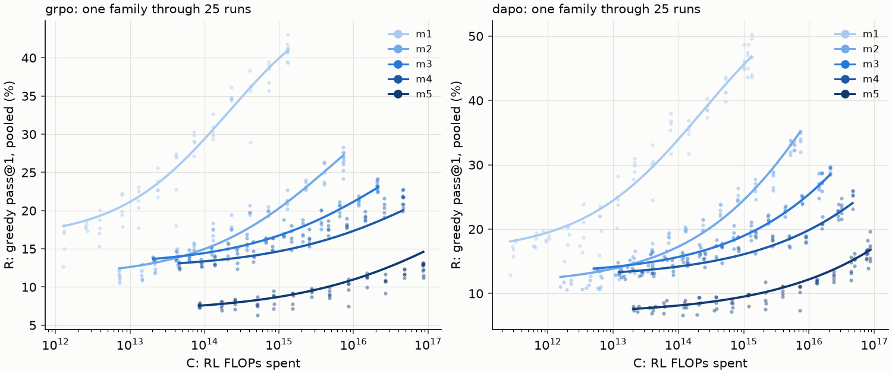
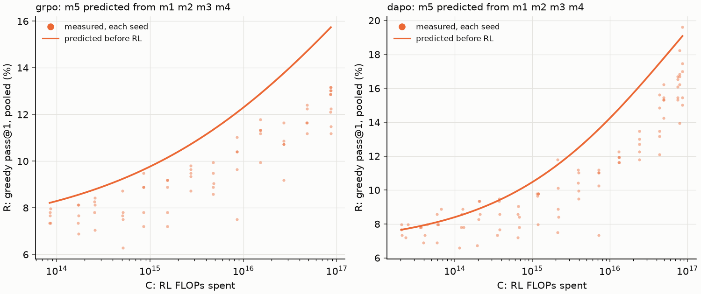
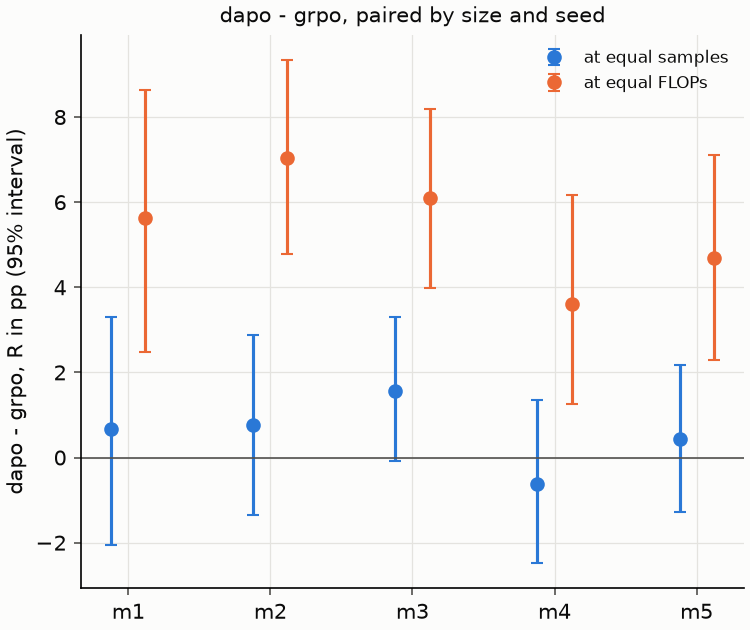

# Write-up 2: how RL gains scale with model size, and how far one fit predicts

ScaleLab M4, 2026-11-17. Figures: `scalelab report scaling` (see Reproduce).

## In short

- We ran 50 RL runs from scratch-trained models of 0.8M to 59M non-embedding parameters
  (five sizes x five seeds x two algorithms, GRPO and DAPO), each on the same FLOP budget
  per size, and fitted **one family of sigmoid curves in compute** whose three parameters
  move linearly in log size. It fits all 50 runs to **1.4 pp (GRPO) and 1.6 pp (DAPO) rms**.
- **The fit pins R where it was measured, not where it is going.** A seed bootstrap gives
  R at each size's last compute to within about 1 pp, but the ceiling A spans about 50 pp
  from m2 or m3 up (GRPO m3-m5 roughly 30-85%).
- **Backtest: one rung up works, the next does not.** Fitted on m1-m3, the family predicts
  m4 from its starting accuracy alone to 1.5 pp (GRPO) and 1.2 pp (DAPO) rms. Fitted on
  m1-m4, it over-predicts m5 by about 3 pp at the end of the run (GRPO 15.7% predicted,
  12.2% measured; DAPO 19.1% v 16.9%), outside the seed bootstrap's interval.
- **DAPO beats GRPO at equal FLOPs (+3.6 to +7.0 pp at every size), and not at equal
  samples** (-0.6 to +1.6 pp, every interval spans zero). Its win is the extra samples our
  FLOP accounting lets it draw, not a better update per sample.
- None of this was pre-registered. The plan was to commit a prediction for two larger
  sizes before running them; those runs were cut, and the backtests stand in for them.

## Setup

| model | layers | d_model | heads | N (non-embedding) | R_0 |
|---|---:|---:|---:|---:|---:|
| m1 | 4 | 128 | 2 | 0.80M | 16.4% |
| m2 | 6 | 256 | 4 | 4.82M | 11.3% |
| m3 | 8 | 384 | 6 | 14.2M | 12.9% |
| m4 | 10 | 512 | 8 | 31.6M | 12.4% |
| m5 | 12 | 640 | 10 | 59.5M | 6.7% |

- **Warm starts.** Each size is first trained by next-token prediction on 20M tokens of
  worked arithmetic solutions (one seed-0 warm start a size; every RL seed starts from it).
  We first trained them on 100M tokens, but that left m5 at 66% or more on multiplication
  at every band up to 5 digits, with little room for RL; we dropped to 20M after seeing it.
- **Task.** Multiplication at 4 and 5 digits, chosen by a rule fixed before looking: the
  bands where the smallest model solves at least 5% and the largest at most 50%.
  **R** = greedy pass@1 over the two frozen eval sets pooled (653 problems). **R_0** = R
  before RL. At 20M tokens R_0 *falls* with size: a fixed token budget undertrains the
  bigger models.
- **RL.** GRPO (clip 0.2, KL 0.04 to the warm start) and DAPO (clip 0.2/0.28, token-mean
  loss, no KL, groups whose 8 answers all score the same dropped). 64 prompts x 8 answers a
  step, constant lr 1e-5, fp16, one T4. Rewards: 1 for the right answer, 0 otherwise.
- **Budget.** Each size gets the FLOPs of 1000 GRPO steps as the cost model prices them
  (`rl.flops`: m1 1.3e15 to m5 8.7e16). A pilot at m1, m3 and m5 showed that none reached
  90% of its fitted ceiling by step 1000. GRPO runs about 1010-1020 steps on that budget;
  DAPO 2233-3446, because a dropped group skips log-probs and training and is not billed.
- **Seeds.** A 10-seed study at m2 and m4 measured the seed spread of final R (sd 0.57 and
  1.02 pp): five seeds give at least 88% power to see a 3 pp difference.
- **C** = the RL FLOPs a run has spent (sampling, log-probs, training), summed over steps.
  Gradings run at steps 0, 1, 2, 3, 6, 10, 18, 32, 56, 100 and every 100 after.

## One family of curves

Each run follows a sigmoid in log compute (the form of Khatri et al., below):

```
R(C) = R_0 + (A - R_0) / (1 + (C_mid / C)^B)
```

R_0 is measured, never fitted. Across sizes, with x = log10(N / 1e7):

```
logit A = a0 + a1 x      ln C_mid = c0 + c1 x      ln B = b0 + b1 x
```

Six numbers fit every grading after step 0 of every run, seeds pooled, by least squares
([scaling.py](../../src/scalelab/analysis/scaling.py), `scalelab joint`).



*Dots: every grading of every seed. Lines: the fitted family at each size's mean R_0.*

| | m1 | m2 | m3 | m4 | m5 |
|---|---:|---:|---:|---:|---:|
| GRPO final R, measured | 41.2% | 26.9% | 23.1% | 21.5% | 12.2% |
| GRPO, fitted | 41.0% | 27.3% | 23.0% | 20.0% | 14.6% |
| GRPO A | 49.3% | 41.3% | 36.7% | 33.4% | 30.9% |
| GRPO A, 95% interval | 45-76% | 38-73% | 33-82% | 29-87% | 26-85% |
| DAPO final R, measured | 46.8% | 34.0% | 29.2% | 25.1% | 16.9% |
| DAPO, fitted | 46.8% | 35.1% | 28.5% | 24.1% | 16.8% |
| DAPO A | 60.3% | 84.4% | 92.1% | 95.3% | 97.0% |
| DAPO A, 95% interval | 55-68% | 64-92% | 52-97% | 42-99% | 35-99% |

*Intervals: 200 seed bootstraps (resample each size's seeds, refit). Residuals: GRPO 1.39
pp rms over 350 gradings, DAPO 1.56 pp over 410.*

- **Gains fall with size**, at this budget: GRPO adds 24.8 pp at m1 and 5.5 pp at m5.
- **Only m1 bends toward a ceiling.** From m2 up the runs are still on the lower half of
  the sigmoid, so a low ceiling reached soon and a high one reached far beyond the data
  fit the gradings about equally well. DAPO's fit takes the second reading (A near 100%,
  C_mid at m5 near 1e20 FLOPs, about 1000x past the last grading), GRPO's the first. The
  intervals are lopsided for the same reason: A and C_mid are not measured here.
- **GRPO misses at m4 and m5** by more than seed noise: m5's measured 12.2% lies below the
  fitted interval (13.7-14.8%). The family's straight lines in log size are not the shape
  of these data at the largest size.

## Backtest: predict the largest size before its RL

Fit the family without the largest size, then predict that size's whole curve from its
measured R_0 alone (`scalelab backtest`), and compare with its five seeds.



| fitted on, predicted | algorithm | fit rms | held-out rms | bias | last R predicted [95%] | measured |
|---|---|---:|---:|---:|---:|---:|
| m1-m3, m4 | GRPO | 1.39 pp | 1.46 pp | -0.85 pp | | 21.5% |
| m1-m3, m4 | DAPO | 1.66 pp | 1.23 pp | -0.02 pp | | 25.1% |
| m1-m4, m5 | GRPO | 1.32 pp | 2.22 pp | +1.92 pp | 15.7% [15.5, 16.0] | 12.2% |
| m1-m4, m5 | DAPO | 1.56 pp | 2.37 pp | +1.84 pp | 19.1% [18.6, 19.4] | 16.9% |

*Held-out rms over every grading of the predicted size's five seeds; bias = predicted
minus measured, averaged. The interval resamples the fitted sizes' seeds only, not the
form, so it is narrow.*

The m4 prediction is as good as the fit itself. The m5 prediction starts close (+0.6 pp at
step 1 for GRPO) and drifts high as compute grows (+2.3 pp at step 100, +3.5 pp at the
end). m4 to m5 is a smaller step in size (1.9x) than m3 to m4 (2.2x), so distance is not
the cause. Our reading: m5 is the most undertrained warm start (lowest R_0, highest N per
token), and nothing in the family knows about warm-start tokens. A prediction for larger
models from this ladder would have been worse, not better.

## DAPO against GRPO: what "equal" means

`scalelab versus` pairs runs by size and seed and reads DAPO at the grading nearest to
GRPO's final measure, then bootstraps the per-problem differences over seeds and problems.



| DAPO - GRPO, pp [95%] | m1 | m2 | m3 | m4 | m5 |
|---|---|---|---|---|---|
| equal FLOPs | +5.6 [2.5, 8.6] | +7.0 [4.8, 9.3] | +6.1 [4.0, 8.2] | +3.6 [1.3, 6.2] | +4.7 [2.3, 7.1] |
| equal samples | +0.7 [-2.1, 3.3] | +0.8 [-1.4, 2.9] | +1.6 [-0.1, 3.3] | -0.6 [-2.5, 1.4] | +0.4 [-1.3, 2.2] |

At equal FLOPs DAPO wins at every size. But our FLOPs count what a step computes, and DAPO
drops the groups whose answers all score alike (about two thirds of them) after sampling
them: they skip log-probs and training, so they cost almost nothing in our accounting,
while generation, which dominates an RL step's time at this scale
([Write-up 1](01-cost-model.md)), still runs all 512 answers. Equal FLOPs buys DAPO
2.2-3.4x the steps. Read at equal samples (GRPO's ~1017 steps against DAPO's 1000), the
difference is gone at every size.

Equal wall-clock time is the comparison a practitioner wants, and these runs cannot answer
it. Per step DAPO is cheaper (m5: 1000 steps took 2.9-3.7 h, GRPO's 4.7-5.1 h), and its
gradings after step 1000 are too sparse to read it at GRPO's hours. The answer is open,
not null. (RLOO, also run, against GRPO at equal FLOPs: m5 +0.25 pp [-1.75, 2.24].)

## Against the published scaling laws

- **Khatri et al., "The Art of Scaling Reinforcement Learning Compute for LLMs"**
  ([arXiv 2510.13786](https://arxiv.org/abs/2510.13786)) fit the same sigmoid to one run's
  early compute and extrapolate that run to far more compute, with pretrained models and
  very large budgets. We fit it across five sizes at once and extrapolate to a size never
  trained. Our data agree that the sigmoid fits a run; they add
  that from small runs on the lower half of the curve, its ceiling cannot be read.
- **Tan et al.** ([arXiv 2509.25300](https://arxiv.org/abs/2509.25300)) fit a power law in
  compute for test loss, with an exponent that depends on size, on pretrained Qwen2.5
  models from 0.5B to 32B, and predict a held-out 72B model. We did not fit their form;
  that comparison is left open. Their extrapolation across size works where ours fails at
  m5. One plausible difference: their models share one pretraining recipe scaled with
  size, ours share one fixed token budget, which leaves the larger models further from
  trained.

Both studies are far larger than this one. This write-up adds a small, fully reproducible
case with seeds, intervals and a held-out size, not a new law.

## Limits

- **Not pre-registered.** The family's form, its fitting choices and the backtests were
  all chosen after the sweep's data existed.
- **One warm start a size.** The size axis has one draw per size; RL seeds share it. R_0
  falls with size, so size and undertraining move together.
- **One task, one learning rate, one budget rule.** Multiplication at 4-5 digits (653
  problems), lr 1e-5 at every size, 1000 GRPO steps' FLOPs. A skill with unlimited
  supervised data is an odd target for RL; it was chosen because it is cheap to verify.
- **Small.** 0.8M to 59M parameters, character-level, trained from scratch. Nothing here
  says how a 1B model behaves.
- **One form.** Only the sigmoid family was fitted; no alternative form was tried.
- **Compute.** About 350 T4 hours in all for M4 (warm starts, pilot, seed study, the 75-run
  main sweep with RLOO).

## Reproduce

The runs: config hash per size and algorithm, seeds 0-4, code at commit 0413a34f, so each
run id is `<hash>-s<seed>-0413a34f`.

| | m1 | m2 | m3 | m4 | m5 |
|---|---|---|---|---|---|
| GRPO | 04568b9187309a00 | a2f03ca3586f3bd7 | f18c79f8cdc97d83 | c885be542cd1b57b | 5b7f83e07935b6fa |
| DAPO | 9e52d8444af3da4a | fda59e83fa576a05 | d6fcb97580964ec2 | 9f1a8171ddc6e4f5 | bc652cd7a72d1ce9 |

With their registry, gradings and metrics under `$SCALELAB_HOME` and the 25 GRPO and 25
DAPO run ids in `$GRPO` and `$DAPO`:

```bash
uv run scalelab report scaling $GRPO $DAPO --out docs/writeups/figs
uv run scalelab joint $GRPO --bootstrap 200
uv run scalelab backtest $GRPO --bootstrap 200
uv run scalelab versus $DAPO --against $GRPO --at samples
uv run scalelab power $GRPO
```

The sweep files are [configs/sweeps](../../configs/sweeps) (`main-grpo.yaml`,
`main-dapo.yaml`). The code: [scaling.py](../../src/scalelab/analysis/scaling.py),
[versus.py](../../src/scalelab/analysis/versus.py),
[scalingreport.py](../../src/scalelab/analysis/scalingreport.py).
